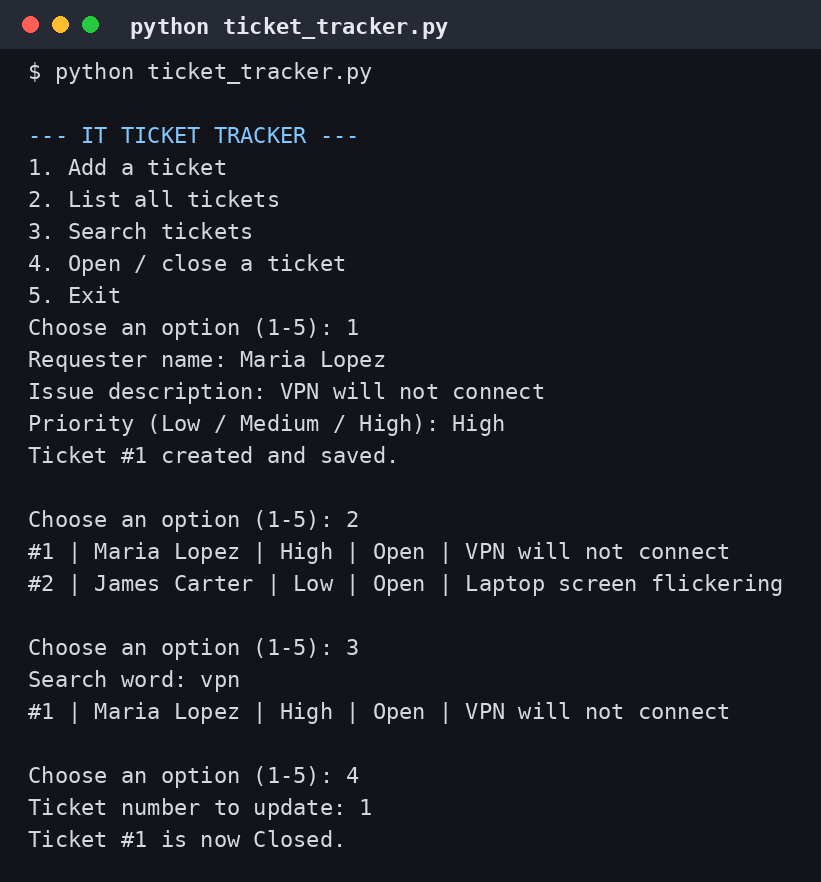

# IT Ticket Tracker (Python)

A help-desk ticket system that runs in the terminal. You can add a ticket, see the whole list, search by keyword, and close a ticket when the work is done.

Tickets are saved to a JSON file, so they are still there the next time the program runs.



## How to run it
```
python ticket_tracker.py
```
Then pick a number from the menu (1-5).

## What it uses
- Functions for each job (add, list, search, update)
- Lists and dictionaries to hold the tickets
- Saving and loading JSON files so data does not disappear
- A menu loop with user input
- Checking input before saving, so a ticket with no name or no issue is not saved

## Why I built it
I have worked in ServiceNow and Jira ticket queues for years. I rebuilt the basic idea myself in Python to understand how a ticket system works under the hood.

By Tamara Geffrard — DeVry University, B.S. Software Development (in progress)
